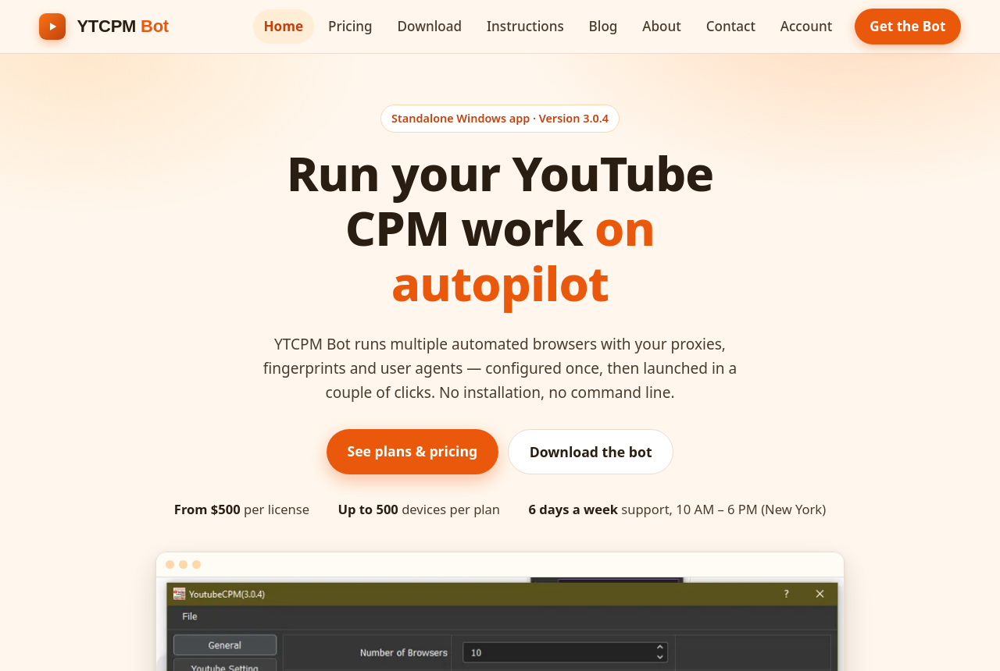

# YTCPM Bot — Website

The official website for **YTCPM Bot**, a standalone Windows app for YouTube CPM
workflows: licensing store, crypto checkout, customer accounts, admin
dashboard and blog.

**Live:** https://ytcpm.cyou



## What the site does

- **Storefront** — homepage, pricing, download and a full setup guide
  (prices and the bot version on the homepage come live from the admin
  dashboard settings).
- **Crypto checkout** — pick a package, pay in USDT / BTC / ETH, upload the
  payment screenshot; orders can auto-confirm on-chain (mempool.space /
  Trongrid / Etherscan) when a transaction hash is provided.
- **Customer accounts** — registration with full profile details and email
  verification; a dashboard showing every license with activation/expiry,
  remaining days and the bot login (visible once the admin marks the
  license done); profile editing, password change, priority support for
  active licenses.
- **Admin dashboard** — orders, bot licenses, support requests, contact
  messages, packages & prices editor, payment/download settings, and a
  **Users** section (all customers, per-user details and licenses, manual
  user creation and license assignment). Admins are separate accounts —
  customers can never sign in to /admin.
- **Blog** — guides on YouTube CPM/RPM, proxies, browser fingerprints and
  user agents, with branded cover images.
- **SEO & discovery** — canonical URLs, full Open Graph/Twitter cards,
  JSON-LD structured data (WebSite + Organization + SoftwareApplication,
  BlogPosting on articles, FAQPage on /faq), plus hand-rolled endpoints:
  `/sitemap.xml`, `/rss.xml`, `/robots.txt`, `/ads.txt`, `/llms.txt`.
  All of it is driven by one file: `src/config/site.ts`.

## Stack

- [Astro](https://astro.build) 7 + TypeScript, SSR with a portable adapter
- PostgreSQL (orders, accounts, packages, settings — schema is created
  idempotently by `src/lib/db.ts`)
- [better-auth](https://www.better-auth.com) for customer accounts; a
  separate `admin_users` table + signed cookie for admins
- Resend for verification email; payment screenshots via local disk,
  S3/R2 or GitHub storage drivers (`src/lib/storage.ts`)
- Deploys to **Cloudflare Workers** (primary), **Node** or **Vercel**

## Quick start

```bash
npm install
cp .env.example .env   # fill in at least DATABASE_URL + admin values
npm run dev            # local dev server
npm run build          # production build (Cloudflare target)
```

Local production-like run (same config Cloudflare uses):

```bash
npm run build
npx wrangler dev -c dist/server/wrangler.json
```

## Configuration

Every environment variable is documented in [`.env.example`](.env.example).
The full payments/accounts setup — including the Cloudflare
runtime-variables rule and the go-live checklist — is in
[`PAYMENTS_SETUP.md`](PAYMENTS_SETUP.md).

## Deployment

| Target     | Command / setup                                                                 |
| ---------- | ------------------------------------------------------------------------------- |
| Cloudflare | Push to `main` — Workers Builds deploys automatically (Git-connected).          |
| Node       | `npm run build:node` then `npm start` (any VPS).                                 |
| Vercel     | Import the repo — [`vercel.json`](vercel.json) sets the build, clean URLs and headers. |

The adapter is chosen at build time by `DEPLOY_TARGET`
(`cloudflare` default · `node` · `vercel`); see `astro.config.mjs`.

## Project map

```
src/
  config/site.ts     SEO/discovery single source of truth
  components/        Header, Footer, shells, home sections, StructuredData
  content/blog/      Blog posts (Markdown/MDX)
  lib/               db, settings, packages, auth, storage, mail, profile…
  pages/             Storefront, account, admin, pay + .ts endpoints
public/
  YoutubeCPM.zip     The bot download
docs/images/         README images
```

Working on this repo? Read [`AGENTS.md`](AGENTS.md) first — conventions,
push rules and the docs trio (`AGENTS.md` / [`CLAUDE.md`](CLAUDE.md) /
[`MEMORY.md`](MEMORY.md)) that must stay in sync with the code.

---

© YTCPM. The YTCPM Bot is an independent tool and is not affiliated with or
endorsed by YouTube or Google.
